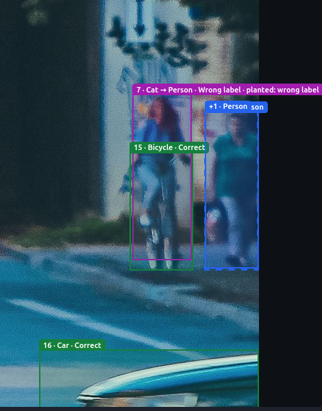
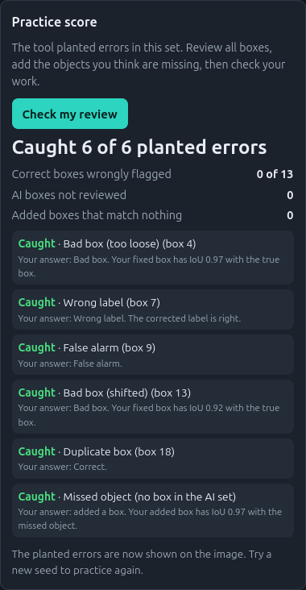
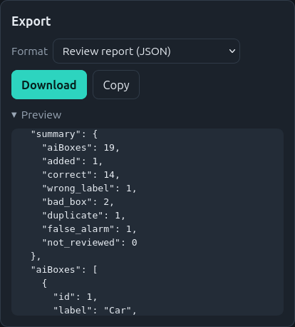

# AI Box Review Tool

A browser tool to practice reviewing boxes made by an AI model. It runs fully in the browser. No backend, no API key, no install.

**Live demo:** https://mdshahedulislamsaim.github.io/ai-box-review-tool/

> This is an educational practice tool. The practice score shows how many planted errors I found in one set of boxes. It is not a certified accuracy result.

## Screenshots

**Reviewing boxes, with the zoom bar**



**Practice score, with the planted errors shown**



**Review report export**



Photo by Vlad Fonsark on [Pexels](ADD-THE-PEXELS-LINK).

## What it does

- Load an image and a COCO file of AI boxes, then give each box a verdict: Correct, Wrong label, Bad box, Duplicate or False alarm
- Fix wrong labels, and fix bad boxes by dragging them
- Draw objects the AI missed
- Zoom (up to 8×) and pan, to review small boxes and fix their edges
- Export a review report (JSON or CSV), or the corrected boxes as COCO JSON
- **Practice mode:** load a file with the correct boxes. The tool copies it and plants known errors, then scores how many I caught
- Self-test panel that checks the practice-set maker, the scoring and the file readers against answers worked out by hand

## How practice mode works

The tool takes the correct boxes and plants these errors, each on a different object:

| Planted error | What the tool does | Counts as caught when |
|---------------|--------------------|-----------------------|
| Wrong label | Changes the label | I mark it Wrong label |
| Shifted box | Moves the box away from the object | I mark it Bad box |
| Too-loose box | Makes the box much too big | I mark it Bad box |
| Duplicate | Adds a second box on one object | I mark exactly one of the two as Duplicate |
| False alarm | Adds a box on empty ground | I mark it False alarm |
| Missed object | Removes one box | I add a box with the right label that overlaps it (IoU of 0.5 or more) |

The answers stay hidden until I press **Check my review**. The score also shows how many correct boxes I wrongly flagged. The same seed always makes the same set, so I use a new seed for each attempt.

## My practice results

**Files:** [street-truth-coco.json](examples/street-truth-coco.json) · [seed1-review.json](examples/seed1-review.json) · [seed2-review.json](examples/seed2-review.json)

**To repeat my attempts:**
1. Download the photo from the Pexels link above and keep its file name.
2. Open the live demo and upload the photo.
3. Click **Make a practice set**, choose `street-truth-coco.json`, and use seed 1 or 2.
Photo: street scene with people, a cyclist, cars and a dog. 13 correct AI boxes and 6 planted errors in each set.

| Attempt | Seed | Planted errors caught | Correct boxes wrongly flagged |
|---------|------|-----------------------|-------------------------------|
| 1 | 1 | 3 of 6 | 1 of 13 |
| 2 | 2 | 6 of 6 | 0 of 13 |

**What I learned from attempt 1:**
- Mark only one box of a duplicate pair. Marking both deletes the object.
- A box on empty ground is a False alarm, not a Bad box.
- Zoom in and scan the whole image for objects with no box.

**Limits of these results:**
- Attempt 2 came after I had seen how the scoring works, so it shows learning on this tool. It does not show accuracy on other photos.
- The score counts my verdict. The quality of my fixes is shown separately under each result row (IoU of my fixed box with the true box).
- The errors are planted by the tool. Real AI mistakes can be harder to see.

## How to check the tool is correct

- Open the **Self-test** panel at the bottom of the page. It runs 23 checks, for example: a perfect review must catch 6 of 6, and a review with no verdicts must catch 0.
- Compare one planted error with the truth file. After **Check my review**, the tags on the image say which boxes were planted.
- Export **Corrected boxes (COCO JSON)** and load it with `pycocotools`:

```python
# Load the exported file with the standard COCO reader.
# If this runs without errors, the file format is valid.
from pycocotools.coco import COCO

coco = COCO("your-file-corrected-coco.json")
print(coco.getCatIds())
```

## Limits

- Practice mode needs a COCO file with the correct boxes for the image I upload (matched by file name).
- Reviewing real AI output needs a COCO file or a results list from a real detector. I did not test it on one.
- Only five labels are used: Person, Car, Bicycle, Dog, Cat.
- Download may be blocked on some browsers. Use Copy if so.

## Built with

HTML, CSS and JavaScript in a single file.

## Credits

- Reference data format: [COCO dataset](https://cocodataset.org)
- Built by M D. Shahedul Islam
